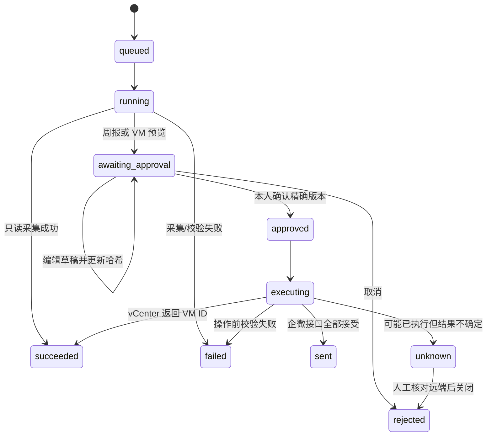

# 企业工作助手

入口：**自动化任务 → 企业工作助手**（`/tasks/enterprise-assistant`）。本模块复用已有 Agent、知识库和用户认证，不要求腾讯云服务，也不在运行时下载插件、浏览器或依赖。

## 1. 启用与权限

管理员保存总开关与四个子模块开关：服务巡检、Jira/OA 待办、周报与企微、VMware。首次安装全部关闭。开启总开关还需开启对应子模块，HTTP 接口、Agent 工具及后台执行均校验开关；普通用户还需 `tasks` 权限。

服务连接和任务属于创建者，只能绑定本人拥有且启用的 Agent。管理员可以管理全局开关，不能借此读取其他员工的连接和结果。停用用户或撤销权限会阻止其待执行任务。关闭模块保留配置与历史，停止新执行；已经送到外部系统的请求无法撤回。

管理员先配置允许访问的**源站**，例如：

```text
https://jira.company.example
https://oa.company.example
https://vcenter.company.example
ssh://server01.company.example:22
https://qyapi.weixin.qq.com
```

没有允许的源站就不能连接。HTTPS 校验开启，API 连接使用系统信任库；企业内部 CA 可通过服务端环境变量 `OCTOP_ENTERPRISE_CA_BUNDLE` 指定 PEM CA 证书包。OA 浏览器需在操作系统/浏览器信任库安装内部 CA，不提供跳过验签选项。内部 HTTP 必须另外显式打开开关。HTTP 接口不跟随重定向。OA 浏览器可加载批准的资源源站，但登录页重定向后不在原源站时不填写密码，跨源写请求和 WebSocket 均阻止。源站配置是管理员授予的网络边界，应配合企业 DNS、出口防火墙和服务账号权限。

## 2. 配置连接

凭证在连接页面填写，使用现有 SecretRepo/Fernet 机制加密保存。API 只返回“已配置”，不返回凭证。更新时留空保留凭证。数据库和加密主密钥应一起备份；不要把主密钥当作数据库外的独立 KMS。

| 连接 | 地址与认证 | 能力与边界 |
| --- | --- | --- |
| HTTP 服务巡检 | 完整 JSON 健康检查 URL；可选 Bearer 或 Basic | `status` 为 `ok/healthy/up/pass` 才通过；仅保存健康事实，不保存任意响应中的敏感配置 |
| SSH Linux 巡检 | `ssh://主机:端口`；用户名、SSH 私钥、受信任渠道取得的服务器 OpenSSH 公钥 | 固定运行 `uname -sr`、`uptime`、`df -P`、`free -m`，不允许模型或配置提供任意命令；结果表示采集完成，不宣称阈值判定通过 |
| Jira | 根 URL；Server/Data Center PAT 用 Bearer，邮箱/Token 用 Basic | v2 使用 `/rest/api/2/search`；v3 使用增强 `/rest/api/3/search/jql` 与分页令牌。配置 JQL，默认当前用户未解决任务；最多 500 条，超限明确失败 |
| OA | 登录页 URL、账号密码、五个固定 CSS 选择器 | 填写用户名/密码、点击登录、等待已登录页面标记、抽取待办。最多 500 条；验证码、MFA、SSO 或页面变化不会自动绕过，需要人工处理 |
| 企微 | `https://qyapi.weixin.qq.com/cgi-bin/webhook/send`，Key 独立填入凭证字段 | 仅向配置群发送文本；按 UTF-8 最多 2,000 字节分段（低于 text 的 2,048 字节限制），每次最多 10 段，确认前超限会要求精简草稿；每段保存接口回执。`sent` 表示接口接受，不表示人已阅读 |
| VMware | vCenter 根 URL、账号密码、批准的内容库 VM 模板 ID、OS 名称、Folder/ResourcePool/Datastore ID，可选 Guest 自定义规范 | vSphere 7/8 `/api` 会话认证，内容库 VM-template deploy。OS 来自预装模板，不进行 ISO/PXE 裸机安装。部署前检查同名 VM。成功保存 VM ID；Guest 启动和自定义规范结果仍需到 vCenter 验证 |

SSH 依赖提前安装：`uv sync --extra enterprise-ssh`，或离线准备相应 wheel 后安装 `octop[enterprise-ssh]`。私钥需为无口令的专用最小权限服务账户密钥，在 Octop 中加密保存。服务器公钥应从服务器管理员或可信资产平台取得，不使用自动信任首次连接。

OA 使用服务端预装 Chromium；可通过服务器环境变量 `OCTOP_ENTERPRISE_CHROMIUM` 指定可信可执行文件路径。配置页面不能指定可执行程序。平台不会运行时联网安装浏览器。此版每次建立独立浏览器上下文登录，不保存 Cookie，不适用于必须人工 MFA 的无人值守登录。

企微是外部服务，使用时需要该源站出口；完全断外网部署可以只启用内网模块、关闭周报发送模块。

## 3. 创建并验证任务

1. 选择本人 Agent，新增服务连接。
2. 新增任务，选择类型及对应连接。先手动执行，查看“执行与确认”中的结果和错误码。
3. 验证后开启任务定时执行；使用 5 段 Cron 和 IANA 时区，例如每日 `0 9 * * *`，周五 `0 17 * * fri`，时区 `Asia/Shanghai`。星期建议使用 `mon`～`sun` 名称；底层 APScheduler 的数字星期从周一 0 开始，勿套用其他 Cron 系统的数字定义。空表达式表示仅手动执行。
4. 周报任务选择已成功采集的来源任务及企微连接。来源最新一次必须成功且不早于 7 天，否则停止生成，避免把旧数据当作本次结果。
5. 周报草稿初始为带来源记录的事实清单。用户可编辑；也可请 Agent 根据证据整理，再到页面检查。确认绑定**精确内容哈希、任务版本、连接版本和目标**，更新配置或修改草稿后旧确认不能重用。
6. VMware 任务仅手动触发，先生成操作预览，确认后才创建。创建账号应限制在批准的内容库和资源池；模板 CPU、内存、网络配置随模板固定，避免模型任意扩大资源。

目前周报使用所选来源的**最近成功快照**，并非自动统计整个 Jira 项目一周的完成量。要形成周报，可配置“本周完成”“下周待办”等不同 JQL 来源任务；不能从每日未完成列表推断已完成工作。

知识问答继续在知识库页面挂载本地或 AKB 知识库，使用原有 `search_knowledge` 工具与 Agent 身份认证 SDK，不在此模块重复实现知识权限。

## 4. Agent 使用

企业工作助手专家模板已补充操作指引。内置工具：

- `enterprise_work_status`：读取当前用户、当前 Agent 的配置和最近运行证据。
- `enterprise_work_run(job_id)`：发起已有任务。返回排队记录不等于执行完成。
- `enterprise_report_draft(run_id, expected_version, content)`：整理待审核草稿，不能确认和发送。

三个工具均从可信运行上下文取得用户和 Agent，不能通过参数指定其他员工身份。模块关闭后调用失败；重新打开后无需重新创建 Agent。工具始终不提供审批、发送、自由网络请求或凭证管理能力。平台通用工具仍遵循既有安全配置；这些约束并非对任意第三方工具或用户自建脚本的全局禁用。

## 5. 执行与故障处理

执行记录保存在本地 SQLite / PostgreSQL，配置与运行快照分开存储，快照不含密钥。数据库唯一约束避免同一任务并发和同一次计划重复入队；状态转换用版本比较更新，重复确认或重复 worker 领取不会重复执行。



- 定时器每两秒检查持久化计划；停机错过超过五分钟的执行跳过，不集中补跑。前一个任务仍在执行、待确认或待核对时跳过重叠执行。
- 单次执行上限 240 秒，JSON 响应和单次证据有大小限制。只读失败明确记录，不把非空模型回答当作业务成功。
- 周报分段保存发送尝试和接受回执，发送前重新检查开关。发送超时、VM 创建超时或执行中断，标记 `unknown` 并保留已知回执，**不会自动重试外部写入**。
- 运行进程失联超过十分钟后，安全的采集/预览记录改为失败，可重新发起；可能已写入远端的记录改为 `unknown`。多 worker 通过数据库领取互斥；同步调度采用比较更新。
- `unknown` 时先去企微/vCenter 核对实际结果，然后手动关闭记录。关闭不会撤回消息或删除 VM；重新发起属于新的显式操作，VM 创建仍会检查同名资源。
- 当前记录页面展示最近 100 次运行，数据保留在数据库。生产环境应按企业要求配置备份、保留周期和外部审计归档。

常见错误：`MODULE_DISABLED`（开关）、`DESTINATION_BLOCKED`（源站）、`AUTHENTICATION_FAILED`（凭证）、`CONFIGURATION_CHANGED`（需重新发起）、`REPORT_SOURCE_MISSING_OR_STALE`（先重新采集）、`SSH_EXTRA_NOT_INSTALLED`、`SSH_AUTH_HOST_KEY_OR_CONNECTION_FAILED`、`OA_LOGIN_OR_BROWSER_REQUIRED`、`VM_NAME_ALREADY_EXISTS`。

## 6. 本地验收建议

先接入测试环境。验证关闭总/子开关均不能执行；不同员工不能访问对方连接；源站外地址被拒绝；修改草稿后旧确认失效；周报确认前没有企微请求；VM 预览确认前没有创建请求；中途超时不会自动重试。再校验真实 Jira 版本、OA 选择器、SSH 公钥及 vCenter 模板权限。

代码自动化测试覆盖状态机、权限隔离、加密回显、目标限制、分页、响应上限、分段回执和进程中断。测试替身通过不等于真实企业系统联调通过；真实账号、网络、浏览器依赖、模板和接口版本需在部署环境验收。

VMware 请求结构参考 [官方 VM-template 部署示例](https://github.com/vmware-archive/vsphere-automation-sdk-python/blob/master/samples/vsphere/contentlibrary/vmtemplate/deploy_vm_template.py)：资源池/文件夹放在 `placement`，VM Home 与磁盘存储分别放在 `vm_home_storage`、`disk_storage`。
