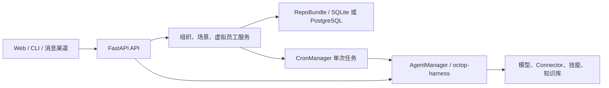

# Octop 产品功能说明与核心实现讲解

> 本文根据 `feature/virtual-employees` 分支的当前代码编写，面向产品、研发、交付和运维人员。代码路径均相对于仓库根目录。它解释“当前代码实际做什么”，不把路线图或设计稿描述成已交付功能。

## 1. 产品定位

Octop 是可自托管的多用户、多 Agent AI 助手平台。用户可以配置模型和 Agent，通过 Web 控制台、CLI、HTTP/WebSocket API 或已配置的即时通信渠道，与 Agent 对话并调用其获准的工具、连接器、技能及知识库。企业功能在这套 Agent 能力之上增加组织岗位、任务场景、审批和证据记录；虚拟员工则把组织岗位与一个已任命 Agent 关联起来，管理职责、阶段目标、工作计划和经过审核的能力改进。

产品设计上的关键分层是：**组织描述“谁负责什么”，Agent 提供“由什么运行时和资源来完成”，权限系统决定“实际上可以做什么”，审批与运行记录决定“是否批准、如何追溯”。** 岗位职责或能力描述不会自动转化为工具权限。

## 2. 功能地图

| 产品区域 | 用户价值 | 主要实现入口 |
| --- | --- | --- |
| Agent 工作台 | 配置 AI 助手、模型、工具、技能、知识和对话 | `src/octop/infra/agents/manager.py`、`src/octop/api/routers/agents.py`、`src/octop/api/routers/chat/` |
| 企业组织 | 管理组织成员、部门、岗位以及人或 Agent 的岗位任命 | `src/octop/infra/organizations/service.py`、`src/octop/infra/db/repos/organizations.py`、`src/octop/api/routers/organizations.py` |
| 企业场景 | 定义某岗位 Agent 可执行的任务提示和 Connector 范围；请求运行、审批、执行和查看结果 | `src/octop/infra/scenes/service.py`、`src/octop/api/routers/enterprise_scenes.py` |
| 虚拟员工 | 为已任命 Agent 建立职责档案，维护阶段目标、计划和能力改进提案 | `src/octop/infra/digital_workers/service.py`、`src/octop/api/routers/digital_workers.py` |
| 运行、存储与运维 | 统一 API、认证、持久化、迁移、审计和任务运行时 | `src/octop/api/app.py`、`src/octop/infra/server.py`、`src/octop/infra/db/`、`src/octop/infra/cron/manager.py` |

## 3. 系统架构和运行原理

Octop 以一个 Python 服务进程承载 FastAPI、Agent 管理器、消息网关和 Cron 调度器。React + TypeScript 仪表盘只通过 `/api` 与后端交互；CLI 是另一种入口。Agent 对话运行时由 `octop-harness`（基于 LangGraph）承载，渠道消息由 `octop-gateway` 接入。控制面数据使用 SQLite 或 PostgreSQL；Agent 工作区则通过统一工作区接口访问，默认落在本地文件系统。

一般请求经过以下步骤：

1. `api/deps.py` 从请求中解析已认证用户；JWT 中间件在路由执行前完成认证。
2. Router 校验 HTTP 参数和请求模型，然后将业务操作交给 `infra/` 服务层。
3. 服务层依据用户、组织角色、Agent 所有权/共享状态和资源授权执行规则；通过 `RepoBundle` 访问数据库。
4. 需要运行 Agent 时，再交由 `AgentManager` 或已有 `CronManager`，最终进入 harness 执行。
5. 前端以类型化 API 模块调用后端，页面层负责表单、状态和结果展示。

此结构让 API 负责协议适配，服务层负责业务规则，Repo 负责 SQL 和持久化，Agent 运行时负责模型推理和工具调用。详细模块边界见 [架构说明](architecture.md) 和仓库根目录 `AGENTS.md`。

## 4. 核心功能详解

### 4.1 Agent、模型和工具运行时

**设计目的**：把对话模型、Agent 配置和工具能力组合为可重复使用的数字助手，并通过统一的身份和资源权限控制其访问范围。

**工作原理**：`AgentManager` 从 Agent 数据和配置构建/管理 `HarnessAgent`，调用 `stream()`/`call()` 完成流式或单次推理。聊天 Router 负责建立或恢复 thread、检查 thread 与 Agent 的归属、整理输入内容，再把请求送进运行时。模型提供商、MCP Connector、Skill、知识库等成为 Agent 的配置资源；具体工具能否被调用还取决于 Agent 配置、用户授权和运行时安全策略。

**主要技术**：FastAPI、asyncio、`octop-harness` / LangGraph、React/TypeScript、WebSocket、数据库 Repo、Agent 工作区适配器。

**代码实现和使用方法**：

- Agent 生命周期与对话封装：`src/octop/infra/agents/manager.py` 中 `AgentManager` 的创建、加载、配置同步及 `stream`/`call` 方法。
- HTTP 对话入口：`src/octop/api/routers/chat/`；聊天 thread 解析在 `chat/turn.py`，流式连接由对应的 WebSocket 路由提供。
- API 装配：`src/octop/api/app.py` 注册 `agents`、`chat`、`providers`、`connectors`、`skill_packages`、`knowledge_bases` 等路由。
- 实际使用：管理员配置模型服务；用户创建或选择有权访问的 Agent；在 Agent 配置中授权需要的技能、Connector 和知识库；用户在仪表盘或 CLI 开始对话。服务端连接模型或外部系统的网络请求由所配置的提供商、Connector 和功能决定。

#### 知识库检索与 Connector 工具

**知识库的原理**：知识库服务验证所有者/共享可见性，解析上传文档，切分文本并生成向量；每个知识库在本地 `index.sqlite` sidecar 中保存文本块及 embedding。对话轮次只检索该轮获准的知识库：查询向量与索引匹配后按相似度排序，在字符预算内整理片段，并附带来源引用。Agent 通过内置 `search_knowledge` 工具按需检索，而不是把整个库内容塞进每个 prompt。

**Connector 的原理**：管理员/用户建立连接实例并配置凭据，Connector 服务通过 MCP/相应适配器将远端系统工具装配到 Agent。每轮对话及企业场景运行均根据调用者授权选择可用 Connector；工具调用仍由 Agent runtime 和安全策略处理。

**实现路径与使用方法**：知识库业务和上传编排在 `src/octop/infra/knowledge/service.py`，向量索引在 `infra/knowledge/index.py`，召回与引用在 `infra/knowledge/retrieve.py`、`infra/knowledge/tools.py`，HTTP 管理入口在 `src/octop/api/routers/knowledge_bases.py`。Connector API/授权和配置主要在 `src/octop/api/routers/connectors.py`、`src/octop/infra/connectors/`；Agent 运行时在 `infra/agents/manager.py` 组装 MCP 工具。用户创建知识库并上传文档，等待处理完成后授权给 Agent；在 Connector 管理页配置远端服务和凭据、测试连接，再把 Connector 授权给 Agent。实际可用能力依赖 embedding/模型设置、远端服务可达性和用户权限。

### 4.2 组织、部门、岗位和 Agent 任命

**设计目的**：将企业工作责任映射到 Octop 的用户与 Agent 资源，使企业功能具备可检查的组织上下文，但避免将组织层级当作 Agent 权限。

**工作原理**：一个组织包含成员、部门、岗位和任命关系。组织角色分为 owner、manager 等；需要管理组织结构的操作由服务层校验管理角色。岗位可绑定部门和上级岗位，服务层会验证关联属于同一组织并阻止层级循环。任命把用户或 Agent 关联到组织岗位；任命 Agent 本身不会授予该 Agent 的所有权，也不会增加其工具或数据权限。

**主要技术**：组织领域服务 `OrganizationService`、`OrganizationRepo`、FastAPI Router、关系型外键和数据库迁移、组织图前端。

**代码实现和使用方法**：

- 业务规则：`src/octop/infra/organizations/service.py`，包含组织角色、成员、部门、岗位、层级校验和 `add_assignment` 等操作。
- API：`src/octop/api/routers/organizations.py` 提供 `/api/organizations`、组织图、成员、部门、岗位及任命的 CRUD 路由。
- 数据持久化：`src/octop/infra/db/repos/organizations.py`；组织表结构见 `src/octop/infra/db/migrations/021_organizations.sql` 及对应 PostgreSQL 文件。
- 界面：`dashboard/src/pages/Organizations/index.tsx`，API 客户端为 `dashboard/src/api/modules/organizations.ts`。
- 实际使用：创建组织 → 加入组织成员 → 建立部门和岗位 → 将可访问的 Agent 任命到岗位 → 在组织页面检查组织图和任命关系。

### 4.3 企业场景：从定义到经审批的单次执行

**设计目的**：将一个可复用任务定义和一次实际运行分开管理，并为运行增加事前审批、执行快照、权限复核和结果证据。

**工作原理**：场景绑定组织、岗位和已任命 Agent，并保存名称、提示词和明确选择的 MCP Connector 名单。成员发起运行时，服务层确认组织成员身份、场景有效、Agent 仍启用且仍被任命，并检查请求者对 Agent 的访问权。请求会保存当时的场景提示、Connector、Agent、岗位及版本信息，进入 `awaiting_approval`。另一位组织经理审批后，服务再次确认 Agent 任命状态和 Connector 权限，再用 `CronCreateSpec` 创建禁用的一次性 Cron 任务，设置精确 Connector allowlist，随后立即执行。最终运行状态会从 Cron 结果同步，运行证据按权限开放查看。

**主要技术**：`EnterpriseSceneService`、`EnterpriseSceneRepo`、版本快照、乐观并发控制、审计事件、已有 `CronManager` / APScheduler、Connector 授权校验和证据访问控制。

**代码实现和使用方法**：

- 场景管理、请求和审批：`src/octop/infra/scenes/service.py` 的 `create_scene`、`update_scene`、`request_run`、`decide_run`、`get_run_evidence_access`。
- HTTP 契约：`src/octop/api/routers/enterprise_scenes.py`；前端相关 API 在 `dashboard/src/api/modules/organizations.ts`，界面位于组织页面。
- 版本与运行数据：`src/octop/infra/db/repos/enterprise_scenes.py`；表结构/快照迁移见 `022_enterprise_scene_versions.sql`、`025_scene_run_worker_plans.sql` 及 `.pg.sql` 配对文件。
- 实际使用：经理建立场景并配置 Agent 与 Connector → 有权成员提交运行请求 → 另一位经理批准或拒绝 → 批准后 Agent 执行一次 → 有权限的成员查看运行状态和证据。

**现阶段限制**：每次运行使用一个 Agent 和一段 prompt；执行方式是复用 Cron 的一次性任务。当前不是可视化 DAG/多 Agent 编排器；不支持场景周期调度、每一步单独审批、自动重试或中断任务自动恢复。Connector 名单是调用边界，但并不自动限制被选 Connector 内每个工具为只读操作。高风险场景仍应通过 Connector/Agent 自身的最小权限配置进行限制。

### 4.4 虚拟员工：岗位职责、目标和计划

**设计目的**：让组织不只管理“有哪些 Agent”，也能表达一个 Agent 在岗位中的职责、阶段目标和经审阅的执行计划。

**工作原理**：虚拟员工是组织内的治理档案，唯一关联一个组织岗位和一个已任命且有权限的 Agent。档案有 draft、active、paused、archived 状态和递增的 `version`。目标有周期、成功标准和状态；仅 draft 目标可改内容或删除。计划挂接到目标，包含方法、步骤和每步预期产出；只有 worker 与目标均 active、方法及步骤完整时，计划才能转为 ready。更新携带 `expected_version`，避免并发修改静默覆盖。该档案不是新的 Agent runtime，也不会创建 Agent、启动任务或授予资源。

**主要技术**：`DigitalWorkerService` 领域规则、`DigitalWorkerRepo` SQL 仓储、Pydantic 请求模型、乐观锁/状态机、SQLite 与 PostgreSQL 成对迁移。

**代码实现和使用方法**：

- 服务层：`src/octop/infra/digital_workers/service.py`；权限校验、组织经理要求、Agent 任命校验、状态转换和版本冲突规则均在此实现。
- API：`src/octop/api/routers/digital_workers.py`，路径前缀为 `/api/organizations/{organization_id}/digital-workers`；支持档案、目标、计划的查看/维护。
- 仓储：`src/octop/infra/db/repos/digital_workers.py`；服务通过 `RepoBundle.digital_worker_repo` 取得仓储。
- UI：`dashboard/src/pages/Organizations/index.tsx`；类型及 HTTP 客户端在 `dashboard/src/api/modules/organizations.ts`。
- 数据表：v23 `digital_workers` 与 `digital_worker_goals`；v24 `digital_worker_plans`；对应迁移位于 `src/octop/infra/db/migrations/`。
- 实际使用：先完成 Agent 任命 → 创建虚拟员工并填写职责 → 激活档案 → 创建阶段目标并填写可验收标准 → 激活目标 → 编写计划、细化步骤和预期产出 → 将计划标为 ready → 将其关联到组织场景并请求审批运行。

### 4.5 虚拟员工能力改进：用证据提出、由他人审核

**设计目的**：将“持续学习和改善能力”实现为可追溯的人审流程，而不是允许 Agent 在运行中自行扩大权限或修改自身配置。

**工作原理**：组织经理只能基于该虚拟员工关联的成功场景运行提交提案。提案包含来源摘要、观察到的差距、建议的技能/知识主题/操作指导、预期收益和风险说明，并记录所基于的能力版本。技能包和知识库 ID 必须已在 Agent 配置中授权；审查时会再次校验授权，以处理提交后资源被移除或 Agent 配置变化的情况。提案作者不能审核自己的提案。批准发布会增加虚拟员工的能力版本；新计划运行会将当时的 worker、目标、计划、版本和能力摘要写入运行快照，并只把 Agent 已获授权的资源 ID 交集作为有效引用。

**主要技术**：成功运行作为证据外键、结构化 JSON 提案、能力版本号、经理双人复核、发布事务、资源授权二次校验、审批快照。

**代码实现和使用方法**：

- 提案校验和审核：`src/octop/infra/digital_workers/service.py` 中 `create_capability_proposal` 与 `review_capability_proposal`。
- 数据更新及并发：`src/octop/infra/db/repos/digital_workers.py`；能力提案表和能力字段见 v26 迁移 `026_digital_worker_capability_proposals.sql` 及 PostgreSQL 配对文件。
- 与运行的关联：`src/octop/infra/scenes/service.py` 中 `request_run` 将计划和能力快照拼入 prompt；`decide_run` 在排队执行前再次核验 Agent 资源授权。
- 实际使用：查看成功运行 → 记录结果与差距 → 提交改进提案 → 另一位经理审核并发布或拒绝 → 后续运行引用新的能力版本。

**能力边界**：发布只更新虚拟员工的描述性能力档案及版本，不会修改 Agent system prompt/config，不会安装 Skill，不会向知识库写入材料，也不会新增工具权限。若希望真的让 Agent 学会新知识或获得工具，管理员仍需通过对应的 Agent、Skill、知识库或 Connector 管理功能完成授权和配置。

### 4.6 数据存储、审计和权限

组织、场景和虚拟员工的数据通过共享 RepoBundle 访问控制面数据库；SQLite 是默认选项，也保留 PostgreSQL 后端。每个数据库迁移使用 SQLite 与 PostgreSQL 成对 SQL 文件。Agent 工作区文件不直接通过业务表存储，而经 `BackendWorkspace` 访问。组织和虚拟员工服务对管理操作写入审计记录；场景审计记录操作类型与目标，避免把提示词或凭证直接写入审计 payload。

身份与授权按层执行：JWT 识别用户；全局管理员或组织 owner/manager 决定组织管理操作；Agent 所有者/共享访问策略决定是否能用 Agent；Agent 配置与 Connector/知识/Skill 资源授权确定实际可用能力。组织成员身份、岗位职责或虚拟员工能力标签都不能替代资源授权。

## 5. 端到端操作示例

以“虚拟员工按阶段目标生成巡检摘要”为例：

1. 管理员配置模型服务，创建或选择一个 Agent，为其配置经批准的只读巡检 Connector 和所需知识资源。
2. 组织经理建立组织、成员、部门和“运维”岗位，并将该 Agent 任命到岗位。
3. 组织经理创建虚拟员工档案、填写职责并激活；为其设定有明确验收标准和周期的目标。
4. 经理在目标下制定工作计划，写明具体步骤与预期输出，并将计划标记为 ready。
5. 组织经理建立与该岗位/Agent 对应的“巡检摘要”场景，填写任务 prompt，选择允许使用的 Connector。
6. 有 Agent 访问权限的组织成员把 ready 计划关联到场景，发起运行申请；申请中记录目标、计划、能力版本和运行 prompt 快照。
7. 另一位组织经理审核运行申请。批准后系统检查 Agent 与 Connector 授权仍有效，再通过一次性 Cron 任务运行 Agent。
8. 运行成功后，经理可基于其结果和差距提交能力改进提案；另一个经理审核后发布。下次运行使用新能力版本快照，但仍受 Agent 实际授权范围约束。

## 6. 当前已实现与未实现边界

| 项目 | 当前代码状态 |
| --- | --- |
| 多用户 Agent 对话、模型与工具配置 | 平台基础能力已实现；实际可用性取决于管理员配置和外部提供商状态 |
| 组织、部门、岗位、成员和 Agent 任命 | 已有服务、API、持久化与组织页面 |
| 企业场景定义、版本、请求、他人审批、单次执行和证据读取 | 已实现；底层执行复用 Cron 和 Agent；按代码和部署配置验收 |
| 虚拟员工档案、目标和计划 | 已实现；当前计划结构化维护，但计划内容由人编辑 |
| 运行快照与能力改进提案审核/发布 | 已实现；是描述性能力档案的治理闭环 |
| LLM 自动生成目标/计划、Agent 自主学习写回 Skill/知识库 | 当前实现中没有此自动闭环 |
| 场景 DAG、多 Agent 多步骤编排、步骤级审批/自动重试/恢复 | 当前场景代码不支持 |
| 身份目录自动同步、岗位与 Agent 的组织级权限继承 | 当前版本不应假定已实现；须使用现有用户与 Agent 授权机制 |
| 生产发布验收 | 查看 [发布就绪评估](release-readiness.md)；文档中记录了数据库平台和部署环境仍需的验证项 |

## 7. 主要代码导航

| 关注点 | 文件/目录 |
| --- | --- |
| HTTP 应用、路由和认证装配 | `src/octop/api/app.py`、`src/octop/api/deps.py`、`src/octop/api/middleware/` |
| Agent 与模型运行时 | `src/octop/infra/agents/manager.py`、`src/octop/api/routers/chat/` |
| 组织服务和数据 | `src/octop/infra/organizations/`、`src/octop/infra/db/repos/organizations.py` |
| 企业场景服务和证据 | `src/octop/infra/scenes/`、`src/octop/infra/db/repos/enterprise_scenes.py` |
| 虚拟员工领域逻辑和仓储 | `src/octop/infra/digital_workers/`、`src/octop/infra/db/repos/digital_workers.py` |
| 调度执行 | `src/octop/infra/cron/manager.py` |
| 数据库 DI 和仓储装配 | `src/octop/infra/db/services.py`、`src/octop/infra/server.py` |
| 企业控制台 UI 与类型化请求 | `dashboard/src/pages/Organizations/index.tsx`、`dashboard/src/api/modules/organizations.ts` |
| 组织/场景架构设计 | `docs/architecture/organization-workforce-model.md`、`docs/enterprise-work-assistant.md` |
| 产品需求和发布风险 | `docs/product-functional-specification.md`、`docs/release-readiness.md` |

## 8. 设计结论

当前产品已经具备从 Agent 能力配置、组织岗位建模，到场景审批执行、结果追溯和虚拟员工能力提案审核的基础企业流程。其核心技术策略是**复用已有 Agent 与 Cron 执行能力，在执行前后增加组织约束、审批、快照和授权复核**，因此可以逐步扩展，而无需把 Agent 执行再造一套。

从产品成熟度看，虚拟员工目前应理解为“与真实 Agent 绑定、由组织管理的工作角色与成长治理对象”，而非拥有独立大脑、自主学习、持续自治执行的数字人。现阶段计划由人创建、运行需审批、资源权限由 Agent 管理；这些边界是当前安全模型的一部分。
