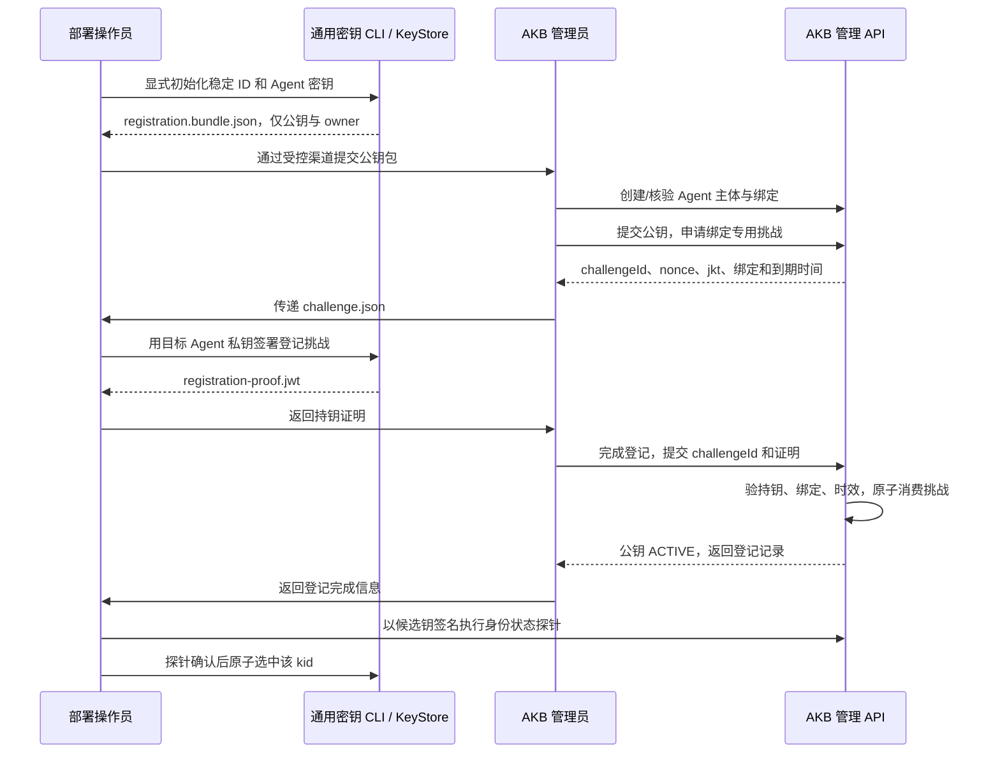
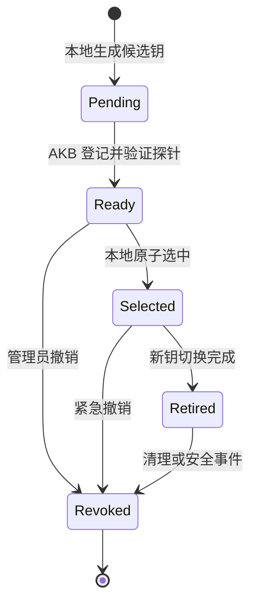

# 稳定模块：Agent 密钥管理规范

状态：V2 已实现，见相邻 agent-identity-sdk。默认文件 Provider 在 POSIX 使用属主与权限位校验，在 Windows 使用 ACL 收紧为仅当前账户；其他平台需注入自定义 Provider。模块独立于 OpenCode、AKB HTTP、MCP 和模型供应商。

## 1. 模块边界

输入为可信管理流程提供的 `AgentKeyOwner`，输出为公开信息或签名句柄。模块不根据提示词、业务参数、操作系统用户名推断 Agent，不保存 AKB 管理员 Token，不自动授权知识库。

```text
Owner = platformId + installationId + workspaceId + externalAgentId
Agent ID = 持久化 UUID，与公钥无关
kid = RFC7638 公钥 SHA-256 指纹，与密钥版本有关
```

`runtimeAgentKey` 是平台执行身份的登记别名，可以在受控迁移中改变。平台有不可变 Agent ID 时优先使用；仅有名称时绑定批准配置，名称变更需管理员重新核验。密钥不由名称、UUID、密码或工作目录哈希派生。

同 Agent 跨安装默认使用不同密钥。Agent ID 是否跨平台保持同一主体必须由管理员明确批准，不能只因显示名相同而自动合并。

## 2. 稳定接口

完整类型见 [contracts.ts](contracts.ts)。生命周期 API 只用于管理流程，不注册成模型工具。

| API | 契约 |
|---|---|
| `initialize(owner)` | 首次显式生成；已有一致记录则返回现有公开信息；损坏、丢失或冲突时报错，绝不覆盖 |
| `stageRotation(owner)` | 生成新的候选版本，保持旧活动密钥不变 |
| `readPublic(owner, kid)` | 返回公钥及元信息，不返回私钥 |
| `selectRegisteredKey(owner, kid)` | 操作员确认 AKB 登记及探针成功后，原子切换本地选择；不代表取得 AKB 授权 |
| `openActiveSigner(owner)` | 返回固定版本的签名句柄，无私钥字节导出接口 |
| `markRetired / markRevoked` | 本地禁用指定版本；撤销 AKB 端必须另行完成 |

`RsaSigner.sign(message)` 执行 RSASSA-PKCS1-v1_5 + SHA-256，message 是原始 JWS signing input 字节，不是已算好的 SHA-256。远端 KMS Provider 必须避免重复哈希。

本地 Provider 内部持有 PEM 不等于业务插件可以导出 PEM；接口不提供私钥返回值。TypeScript 的 private/readonly、句柄和模块边界是工程约束，不能隔离同进程恶意代码。

## 3. 生成和编码规则

- RSA 默认且 V2 首版要求 3072 位；接受的登记长度限定为 3072–4096 位，公钥指数 65537。
- 使用系统密码学随机源。禁止 Math.random、固定随机种子和从 Agent ID 派生私钥。
- Node Provider 优先异步生成密钥，避免密钥生成阻塞宿主工具执行事件循环。
- 本地私钥使用 PKCS#8 PEM；公钥使用 JWK，仅允许 `kty,n,e,kid,alg,use`。
- `alg=RS256`，`use=sig`；所有 Base64URL 无 padding。
- RFC7638 指纹输入为 UTF-8 字节：`{"e":"...","kty":"RSA","n":"..."}`，按此键序，无空格。`kid=base64url(SHA256(input))`。
- 改变算法需要新的协议 profile，不由插件运行时自由协商。未来 Ed25519 可以另开 profile，不能假设现有 AKB/Nimbus 配置已兼容。

## 4. 持久化与并发

示意布局，可由 OS Keychain/KMS 替代：

```text
<受保护根目录>/
  installation.json
  identities/<内部编码owner索引>/
    identity.json               # stable ID、owner、当前 kid、格式版本
    keys/<kid>/private.pem      # 0600；不进入 Agent 工作区
    keys/<kid>/public.jwk.json
    keys/<kid>/metadata.json
```

索引由 Provider 安全编码，不将未经校验的 Agent 名或路径直接拼入磁盘路径。敏感目录 POSIX 0700、文件 0600，父目录不可被工作区用户写入；Windows 必须使用当前运行账户 ACL（icacls 收紧为仅当前账户），不能只调用 chmod。

初始化必须持有 Owner 范围跨进程互斥锁，并采用独占创建。写入临时文件后 flush/fsync，再原子更新 manifest；不覆盖既有私钥。读取使用安全打开及文件句柄属性校验，限制符号链接和父目录替换，不能只用一次 stat 后再按路径读取。

崩溃恢复遇到孤立候选密钥时保留为待处理状态，不自动选中。manifest 引用的私钥缺失时返回 `KEY_UNAVAILABLE`，不能生成新钥冒充原有版本。

热切换以不可变配置版本完成。每个 HTTP 请求固定其 Key、kid 和凭据快照；轮换不修改正在发送请求的 Header。多请求调用可在受控边界刷新签名器，但 Agent 身份不可改变。被紧急撤销的在途旧签名可能被 AKB 拒绝，禁止为“保证成功”自动降级。

## 5. 首次登记：公钥和身份绑定

公钥不是秘密，但“谁有权把它绑定到某 Agent”必须由管理员批准。共享服务 Key 不具有创建主体、登记公钥或扩大授权的能力。



这是人工/自动化管理流程，模型不参与；不需要把管理员 Token 放进普通插件。登记挑战证明持有私钥，但授权仍来自管理员，持钥证明自身不能自动创建 Agent。

挑战绑定 `policyId,bindingId,externalAgentId,jkt,kid,nonce,purpose`，有效期建议 5 分钟且单次使用。登记证明使用独立 `typ=akb-key-registration+jwt` 和 `aud=akb-agent-key-registration`，不能当知识库请求证明使用。AKB 将候选公钥保存在挑战记录中，用这把公钥验签，不能从提交的 JWT 随意选择公钥。

公钥包示意：

```json
{
  "format": "akb-agent-key-registration/v1",
  "platformId": "opencode",
  "installationId": "opencode-office-01",
  "workspaceId": "engineering-01",
  "externalAgentId": "e21cce9c-1b16-4ab8-a76a-bb761df919b8",
  "runtimeAgentKey": "builder",
  "publicJwk": {
    "kty": "RSA", "n": "<base64url modulus>", "e": "AQAB",
    "kid": "<RFC7638 thumbprint>", "alg": "RS256", "use": "sig"
  }
}
```

`format` 是登记文件格式版本，与请求协议 `ver=2` 不同。私钥、Service Key、管理员 Token 不得进入公钥包。

## 6. 轮换状态机

本地状态和服务端状态必须分开，不能用“文件存在”当成“AKB 已信任”。



图中 Selected 是 READY 版本被 manifest 选中的事实，非接口 `localState` 的额外枚举。AKB 端使用 ACTIVE、RETIRING、REVOKED；RETIRING 必须带明确截止时间，REVOKED 为终态。

正常轮换：生成 K2 → 管理员登记 K2 → 候选钥探针 → 原子切换 K2 → K1 设置 RETIRING → 等待所有部署确认切换及请求窗口 → 撤销 K1。建议旧请求接收窗口至少 120 秒，并按部署时钟及最大在途时长调整；不是只睡 60 秒就删除文件。

退休窗口内 AKB 仅接受 `exp <= key.validUntil` 的断言；过期或 REVOKED 密钥即使 JWT 尚未过期也拒绝。公钥状态每次认证检查，不能受远程 JWKS 缓存拖延。

## 7. 丢失、泄漏和迁移

- 丢失私钥：暂停绑定或撤销丢失的 kid；保持稳定 Agent ID，生成新钥并重新登记。不能仅从公钥恢复私钥。
- 单 Agent 私钥泄漏：撤销该 kid 或暂停该绑定，其他 Agent 继续；若宿主被攻陷则应假定其他本地密钥和共享服务 Key 也可能泄漏。
- 共享 Key 泄漏：轮换共享服务 Key；无需仅因此改变所有 Agent ID。V2 断言绑定服务 Key 摘要，新 Key 必须使用新断言。
- 备份：加密备份及恢复权限由部署管理；日志、npm 包、Git、模型上下文和公钥登记包不携私钥。
- 跨机器迁移：默认新安装 ID、新密钥及重新审批；确需保留安装身份时执行受审计迁移，避免克隆后两个宿主共用同一身份和密钥。

## 8. 可替换 Provider

本地文件 Provider 是默认实现；OS Keychain、PKCS#11、云 KMS 可以实现同一 `RsaSigner`。KMS 的签名授权也必须按 Owner 限制，不能让任意插件提交别的 Agent keyRef。

代理/sidecar 不是必选项。若使用，通道必须认证宿主或执行实例，并将通道绑定到批准 Agent；操作系统 UID 只能区分 UID，相同 UID 下多个 Agent 还需要受保护宿主分发的执行能力。能力泄漏仍可冒用，不能把“由代理签名”宣传为天然强隔离。
