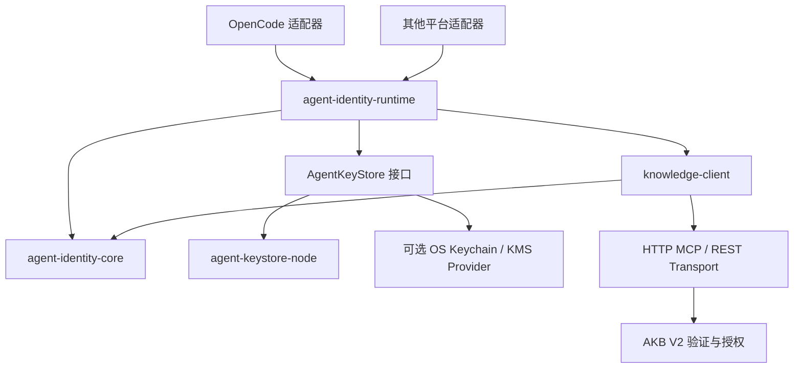
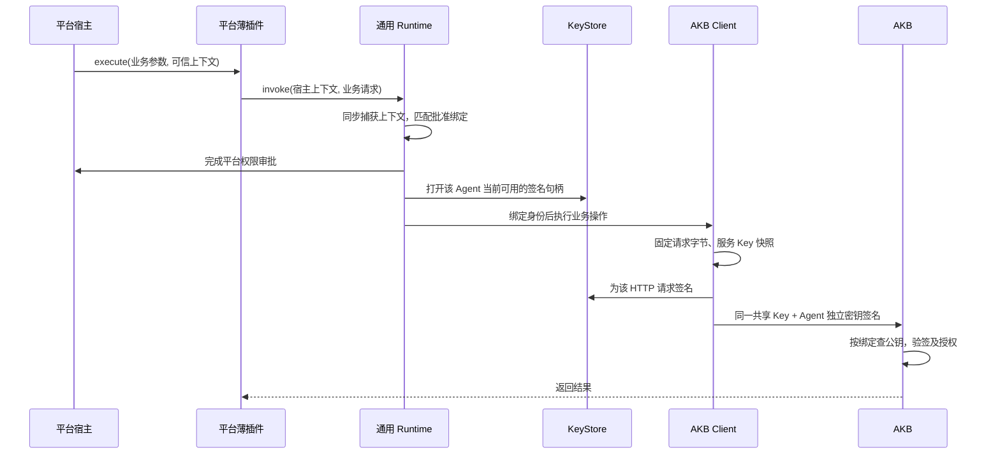

# 跨 Agent 平台身份插件设计

状态：已落实于 SDK 0.3.2 / OpenCode 插件 0.2.1 和 AKB V75。本文保留模块设计说明；实际可构建代码见 [SDK](../agent-identity-sdk/README.md)。SDK 尚未发布公共 npm，现有 OpenCode 插件支持显式 V2，并保留 V1 兼容。

## 目标和关键决定

不同 Agent 平台只编写薄适配器，复用密钥管理、身份断言和 AKB MCP/REST 客户端。插件无需运行独立服务，也无需为了发布公钥搭建 JWKS 网站。

- 一个安装/策略可保留一个共享 AKB Service Key，所有已登记 Agent 共用。
- 推荐每 Agent、每安装独立生成密钥对，由 AKB 将公钥绑定到具体 Agent；不再用安装公钥替整个安装的所有 Agent 签名。
- Agent 稳定 ID 与密钥分开：ID 为持久化 UUID，kid 为公钥指纹。轮换密钥不改变 Agent ID。
- 模型只提供业务参数；运行身份必须来自可信宿主执行上下文。
- SDK 不提供可被模型调用的“设置 Agent ID”“导入私钥”“任意签名”工具。
- 协议是跨语言契约；TypeScript 是第一份 SDK 设计，不要求 Python/Rust/Java 平台运行 Node 服务。

如果本次“公私钥模块稳定”仅指封装现有安装私钥，也可先按同样接口提取模块并继续 V1；但推荐目标是每 Agent 独立密钥的 V2。两者通过显式 profile 区分，不能把 V1 换成多把钥匙后声称已具备 Agent 公钥绑定。

## 模块与依赖



| 逻辑模块（首版为单包子入口） | 负责 | 不负责 |
|---|---|---|
| `@akb/agent-identity-sdk/core` | 协议类型、声明构造、精确字节摘要、RFC7638 kid、签名器端口 | OpenCode、Effect、文件系统、AKB 管理权限 |
| `@akb/agent-identity-sdk/keystore-node` | RSA 生成、受保护落盘、独占初始化、密钥版本、签名句柄 | 平台身份判定、HTTP、知识库逻辑 |
| `@akb/agent-identity-sdk` | 可信上下文快照、绑定查找、审批、选择 Agent 签名器、调用编排 | 平台 SDK 类型、控制台管理、直接暴露私钥 |
| `@akb/agent-identity-sdk/client` | AKB 路由、业务参数白名单、MCP/REST 编码、逐请求认证头、超时及错误 | 自行推断 Agent、密钥生成、自动授予权限 |
| 各平台插件 | 工具注册、捕获平台上下文、平台审批与取消、输出映射 | JWT、RSA、公钥登记协议的自行实现 |

第一阶段可在一个 monorepo 中按上述目录划分、统一发布兼容版本，不必先部署五个微服务。只有平台插件依赖平台 SDK；通用四个模块不得依赖 `@opencode-ai/plugin` 或 `effect`。

## 运行流程



## 开发者入口

1. [插件开发文档](PLUGIN-DEVELOPMENT.md)：最小插件、稳定接口、配置、错误、验收。
2. [密钥管理规范](KEY-MANAGEMENT.md)：Agent 密钥生成、持久化、登记、轮换和丢失恢复。
3. [V2 线协议](PROTOCOL-V2.md)：其他语言 SDK 和 AKB 服务端共同遵守的请求契约。
4. [TypeScript 接口草案](contracts.ts)、[平台适配示例](examples/platform-adapter.ts)。接口是实际 SDK 类型快照；示例展示依赖注入，SDK 可通过本地构建 TGZ 安装。
5. [公共测试向量](examples/protocol-v2-vectors.json) 和 [向量检查脚本](verify-design.mjs)。仅验证草案示例自洽，不代表 SDK 或 AKB V2 已实现。
6. AKB 配套改造文档：AKB 仓库 `docs/design/AGENT-IDENTITY-SDK-V2.md`。

## 版本与迁移

| 模式 | 公钥来源 | Agent 与公钥关系 | 当前状态 |
|---|---|---|---|
| V1 安装断言 | 管理员登记的远程 JWKS | 一把安装密钥可声明多个已登记 Agent | 已实现 |
| V2 Agent 断言 | 管理员登记在 AKB 的具体 Agent 公钥 | 公钥必须属于当前 Agent 绑定 | 已实现 |

SDK SemVer 与协议版本独立。V2 客户端不得自动回退 V1、LEGACY 或无断言请求。AKB 策略显式选定 profile；旧策略默认 V1，新 V2 策略不能接受 V1 安装签名。

## 安全边界

每 Agent 一把钥匙可以阻止“仅泄漏 A 私钥便声明成 B”，前提是 AKB 严格核对公钥所有者。它不能阻止同时有权读取 A、B 私钥的同 UID 恶意进程。

本地文件模式依赖可信宿主。需要隔离不可信 Agent 时，将 shell/文件工具放到独立 UID/容器，将签名器放到受保护进程；签名器还必须验证调用者执行身份。一个接受任意 agentId 的签名服务会重新引入冒充问题。

## 本次文档验证

可使用现有插件的 TypeScript 编译器对接口和示例进行无输出类型检查：

```sh
node ../opencode-identity/node_modules/typescript/bin/tsc --noEmit --strict --target ES2022 --module NodeNext --moduleResolution NodeNext --lib ES2022,DOM contracts.ts examples/platform-adapter.ts
node verify-design.mjs
```

本目录提供规范与公共向量；实现位于相邻 agent-identity-sdk/opencode-identity，AKB 配套为 V75。未发布 npm 包。

独立项目与交付边界见 [PROJECT-DELIVERY.md](PROJECT-DELIVERY.md)。TGZ 可通过 `test-packages.mjs <SDK绝对路径.tgz> <插件绝对路径.tgz>` 在无相邻源码的临时宿主中验收安装、加载及四份随包配置。
